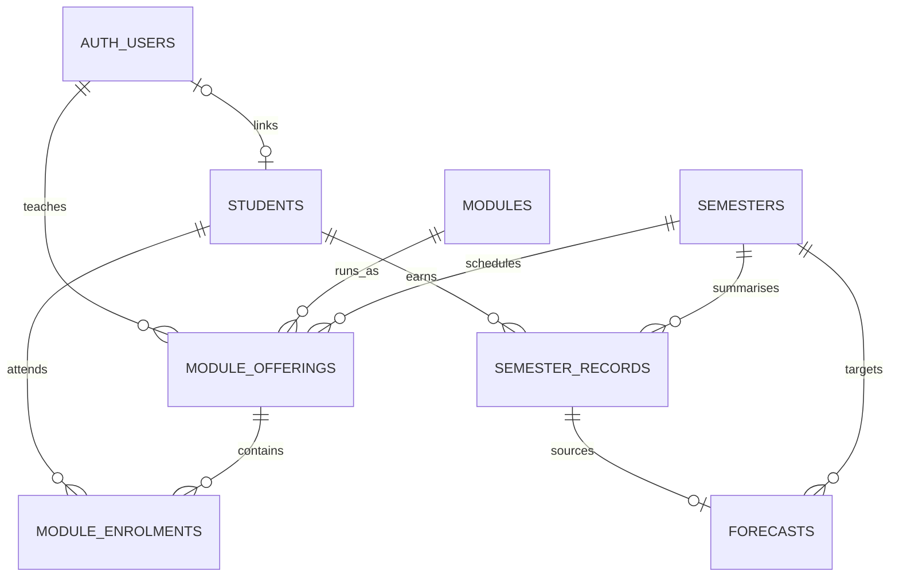

# Project specification

The Student GPA Prediction System gives students their own academic results and a forecast for the next semester. Teachers review results and intervention flags for their assigned module offerings. The development project uses fictional students and synthetic academic records.

## Current state

| Workstream | Status |
| --- | --- |
| Data and model | Dataset profiling, cleaning, training, and held-out evaluation are available. The backend uses the saved XGBoost artifact. |
| Database and backend | The seven-table schema, demo finalisation, forecast publisher, Supabase Auth integration, and dashboard data services are implemented. The development handoff verified 24 linked students, three teacher accounts, and 24 latest forecasts. |
| Streamlit | The app shell and student and teacher pages are pending in this checkout. The backend interfaces are ready for integration. |
| Full application validation | Browser-level sign-in, logout, rendering, and deployment checks are pending. Privacy and ethics documentation and real-world model validation remain separate work. |

See the [team ownership and handoff checklist](TEAM.md) for who does what.

## How the system works

1. **Prepare academic data.** `database/seed.py` generates the fictional cohort using the checked-in sample for comparable model inputs. It exports an owner-run transaction from `database/finalize_demo.sql`. The transaction reconciles module results with actual semester GPA, cumulative CGPA, credits, and attendance.
2. **Prepare forecasts.** The operator runs `services/forecast_publisher.py` after academic finalisation. It reads eligible latest records, calls `services/predictor.py`, and sends raw next-semester GPA estimates to Supabase. PostgreSQL validates the source revision and derives displayed GPA, projected CGPA, and the warning flags.
3. **Serve the dashboards.** The Streamlit integration calls `AuthService` for password sign-in and `DashboardData` for role-specific reads. Both use the HTTPS transport in `services/database.py`. Supabase Auth supplies the user session. The Data API queries PostgreSQL under that user's permissions.

Python runs the backend, pandas prepares model inputs, and XGBoost scores the saved model. The training scripts use scikit-learn for data splits and evaluation. Streamlit will serve the app and render the screens. Altair and Plotly are available for charts. See the [setup instructions](../README.md#local-setup), [database runbook](../database/README.md), and [dashboard integration guide](../services/README.md).

## Database relationships

[database/schema.sql](../database/schema.sql) is the source of truth for table definitions, constraints, triggers, grants, and Row Level Security (RLS).

`auth.users` belongs to Supabase Auth. The application uses these seven tables in the `public` schema.

| Table | One row represents |
| --- | --- |
| `students` | A student identity with an optional unique link to their Auth account. |
| `semesters` | A term in calendar order, with a possible next term and forecast cutoff. |
| `modules` | A module in the course catalogue. |
| `module_offerings` | A module instance for a semester and section, assigned to one teacher account. |
| `module_enrolments` | An enrolled student in an offering, with results, attendance, and GPA-bearing credits as applicable. |
| `semester_records` | A student's actual results and model inputs for a completed term, with revision and reconciliation status. |
| `forecasts` | The published forecast for one student and source semester, with its target semester, model identifier, and revision. |

## Academic and forecast rules

- Completed module results use the [demo grading policy](../database/README.md#demo-academic-policy). Actual semester GPA is credit-weighted within one term. Actual CGPA is credit-weighted across completed terms.
- A module score **≤ 55%** triggers a teacher intervention flag. Teachers see all students in their assigned offerings, including unflagged and pending results. Module assignment determines visibility.
- A forecast uses the latest completed term's reconciled record. Publication needs a valid next term and all ten model inputs. The record must be finalised by the cutoff, and publication starts at the cutoff.
- The **raw predicted GPA ≤ 2.2** and **projected CGPA ≤ 2.2** flags are independent student warnings. The displayed GPA is bounded to 0–4. Projected CGPA combines actual cumulative GPA and credits with the bounded estimate and planned next-term credits. If the credits for projection are unavailable, a valid GPA estimate can still be shown.
- Academic changes can invalidate a forecast through revision checks. The operator reconciles the affected records and explicitly republishes a correction with a reason. Publication preserves the previous forecast row until a controlled correction replaces its values.

## Access and integration

Supabase Auth identifies the caller. The application role comes from administrator-managed `app_role` metadata. PostgreSQL checks the role, account link, offering assignment, and current forecast revision. SQL grants limit which columns and operations an account can use, while RLS controls which rows it can read. RLS is enabled on every application table.

Students can read their own module results, reconciled semester histories, and valid published forecasts. Teachers can read the identities and module results of students enrolled in their assigned offerings. Forecasts and semester GPA/CGPA are student-only for dashboard users. The private schema contains policy helpers and the forecast-validity view. The publisher uses a separate trusted connection.

### Planned dashboard presentation

- **Student** — actual GPA and CGPA history, the latest next-semester estimate and projection, and two separate warning states. Label predictions as estimates. Show an unavailable state for missing predictions. The model artifact includes global feature importance. Individual explanations are a separate feature.
- **Teacher** — module and semester selection, a sortable roster with scores and attendance, and the module intervention flag. Include pending results and unflagged students.
- **Shared UI** — keep page layout in `views/` and reusable charts or metrics in `components/`. Use server-side session state per signed-in user. Read profiles through `services/` and keep user-scoped data out of shared caches.

The original [Streamlit dashboard layout guide](https://discuss.streamlit.io/t/building-a-dashboard-in-python-using-streamlit/60621) remains a UI design reference.

## Repository layout

| Path | Purpose |
| --- | --- |
| `database/` | Schema, synthetic seed generator, and academic finalisation. |
| `services/` | Supabase HTTP transport, authentication, dashboard data, predictor, publisher, and backend service tests. |
| `data/`, `model/` | Dataset preparation, checked-in sample, training, evaluation, and model artifacts. |
| `docs/` | Dataset and model reference, with report and presentation material owned by the documentation workstream. |
| `internalprojectDAC4/` | Project specification, team roles, workflow, and agent instructions. |
| `app.py`, `views/`, `components/`, `.streamlit/config.toml` | Planned Streamlit shell, pages, reusable UI, and app theme. |
| `tests/` | Planned shared application, privacy, and ethics tests. |

Keep real student data and raw or processed Kaggle files out of Git. Store the dashboard's publishable key in ignored local secrets or deployment secrets. Provide the publisher key only to a trusted operator. Use the [workflow guide](WORKFLOW.md) for review and handoff.
